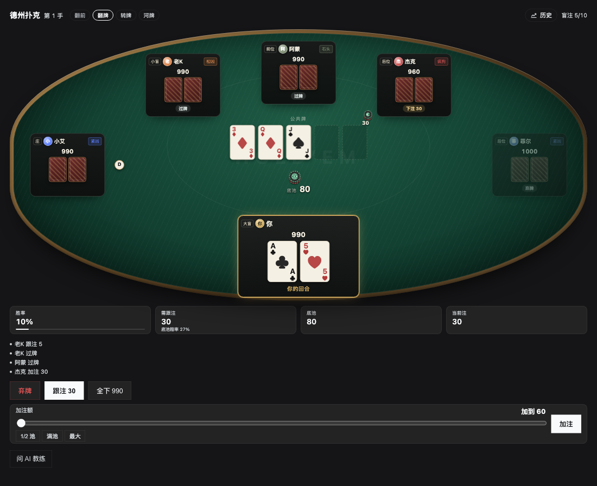
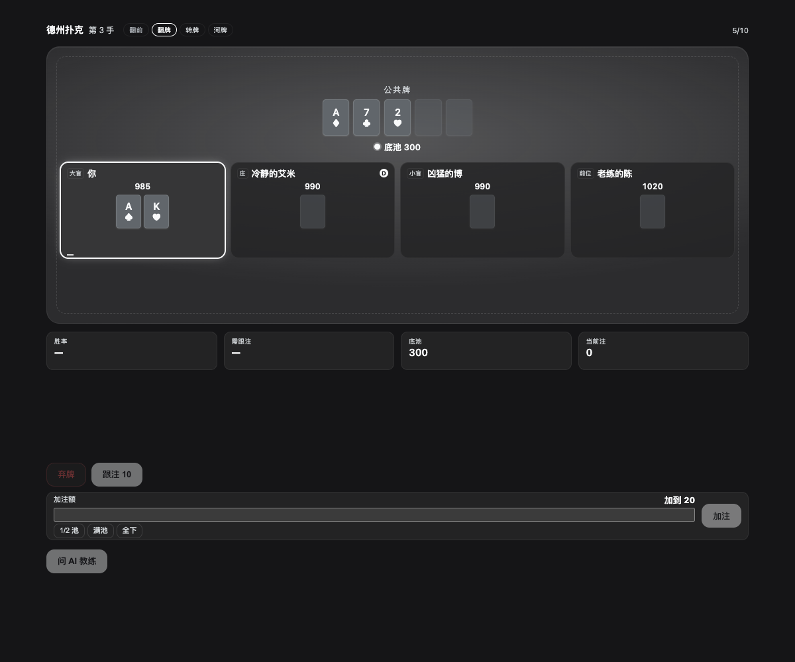
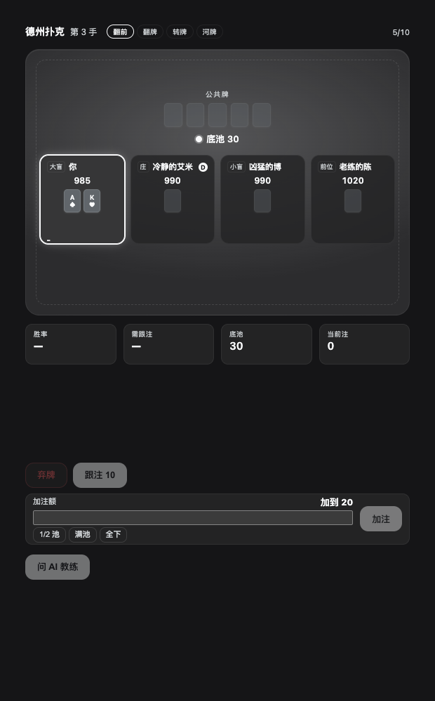
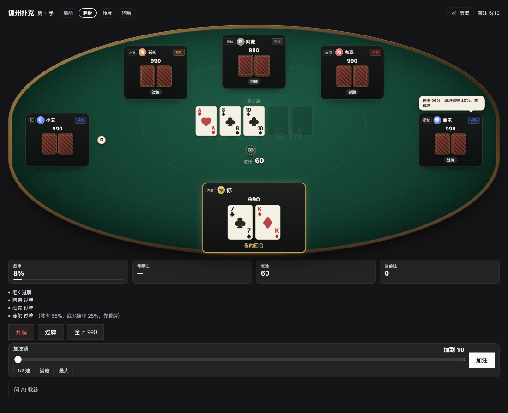
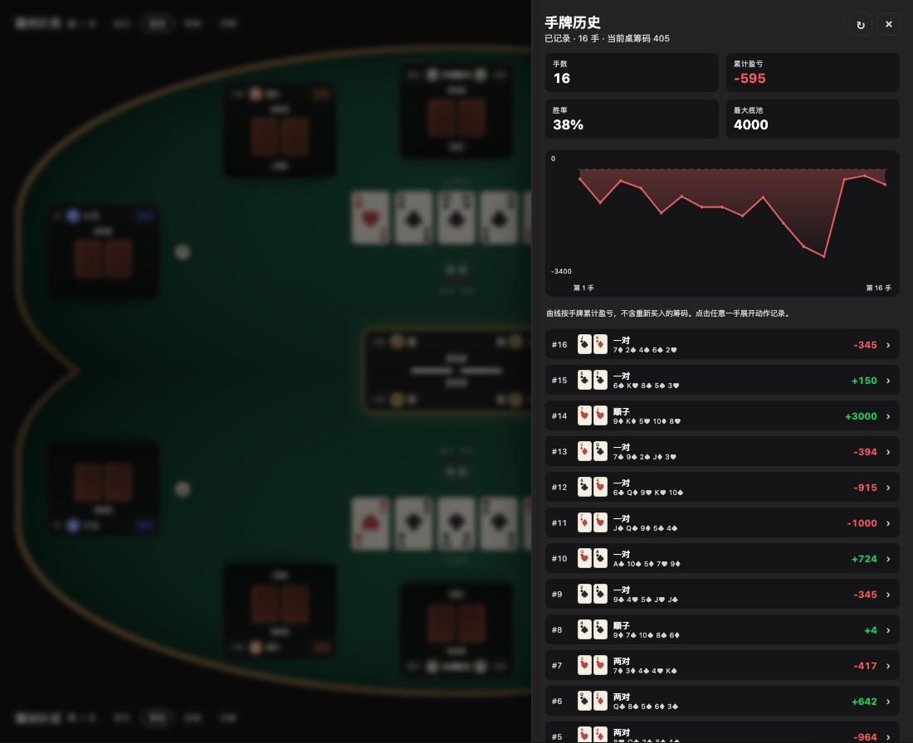
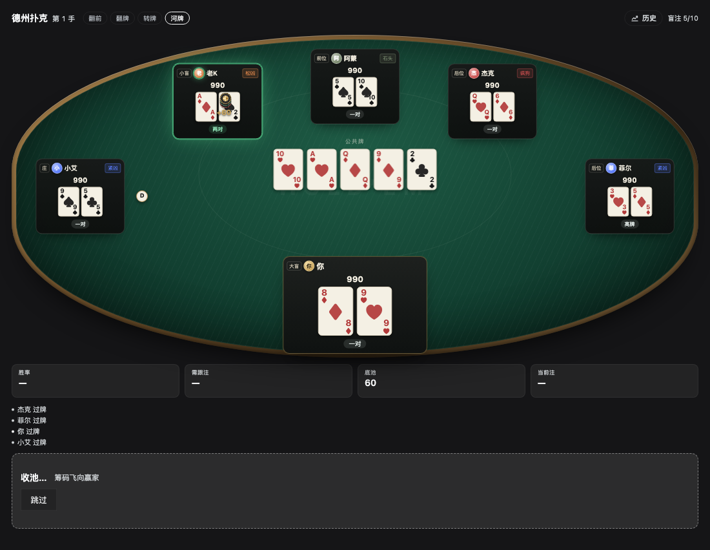
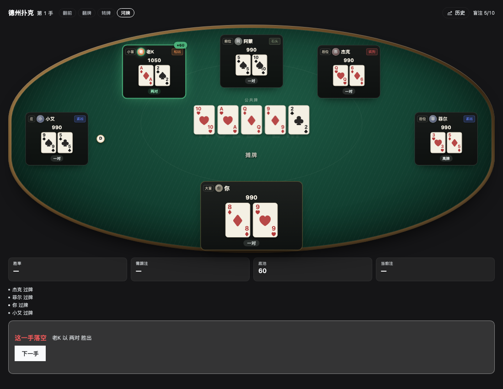

# dsh-poker · 德州扑克

一个跑在 [DeepSeek Harness](https://github.com/deepseek-ai) 里的无限注德州扑克面板：默认 6 人桌，你和 5 个 AI 对手（4 种性格）陪打，桌上有筹码、头像、真实思考气泡和摊牌收池演出；点「问 AI 教练」可以让当前会话的模型给你一手牌的建议，点顶栏「历史」可以翻看跨重启保留的手牌记录与累计盈亏曲线。





## 玩法

- 起始筹码 1000，盲注 5/10，每手牌结束后点「下一手」继续。
- 默认 5 个 AI 对手（6 人桌），有 4 种性格（紧凶、松凶、石头、疯狗），按座位轮换；每人有风格色头像和标签，下注前会有 0.25–1.4 秒的思考停顿，所以你能看见他们轮流行动。
- 你行动时给出 弃牌 / 过牌 / 跟注 / 加注，加注面板带滑杆和 1/2 池、满池、最大三个快捷键。
- 牌桌上方一条街进度条（翻牌前 → 翻牌 → 转牌 → 河牌），牌桌下方实时显示胜率、需跟注（含底池赔率）、底池、当前注。
- 自己是底部中间的主角位，1–5 个 AI 对手沿椭圆桌上半弧排座；6 人桌是左/左上/上/右上/右。对手的下注筹码摆在座位与底池之间，底池中心有筹码堆，庄家 D 贴在庄家座位旁。
- 每个座位底部显示最近一次动作（跟注 10 / 加注到 60 / 弃牌 / 全下 990），当前行动者有呼吸描边，AI 思考时显示三点；AI 行动后还会把这一步的真实想法在座位旁显示约 2.8 秒。
- 全下会正确切分边池，无人跟的多余下注会退回；摊牌亮出的牌型（两对、顺子等）会中文化标在座位上，弃牌的手牌不会被翻开。
- 摊牌演出：逐张亮牌 → 底池筹码飞向赢家 → 结果条；可点「跳过」，减少动效时直接到结果。
- 顶栏「历史」打开手牌历史抽屉：手数、累计盈亏、胜率、最大底池 + SVG 曲线；每手可展开完整动作流水。
- 历史保存在本机 DSH storage，最多 200 手，重启 Harness 不会清空；盈利曲线是「手牌累计盈亏」，不含重新买入的筹码。

## 安装

### 方式一：npm（推荐）

已发布在 npm：**`dsh-texas-poker`**。在 Harness 的插件管理里安装 bundle，spec 填：

```
dsh-texas-poker
```

Harness 会用 pnpm 把它装进当前 profile，并把 `dsh-texas-poker` 加进 `dsh.profile.bundles`，然后重启即可。升级：`pnpm update dsh-texas-poker` 再重启。

（`0.0.0-stage` 是 npm 给新包做首次自动审核时生成的占位版本，`latest` 已经指向 1.0.0，正常安装不会碰到它。）

### 方式二：直接从 GitHub 装

spec 填下面任意一个，效果和 npm 一样（Harness 用 pnpm 从仓库克隆）：

```
github:garyleelty/dsh-poker
https://github.com/garyleelty/dsh-poker
```

git 形式的安装会钉在安装当时的 commit 上，想升级要重新装一次（`pnpm update dsh-texas-poker`，或卸掉再装一遍），然后重启 Harness。

### 方式三：克隆到本地改代码

```bash
git clone https://github.com/garyleelty/dsh-poker.git ~/code/dsh-poker
```

编辑你的 profile（例如 `~/.dsh/profiles/desktop/package.json`）：

```jsonc
{
  "dependencies": {
    // 必须是绝对路径；link: 会跟着本地改动实时生效
    "dsh-texas-poker": "link:/Users/你/code/dsh-poker"
  },
  "dsh": {
    "profile": {
      "bundles": [
        "@deepseek-ai/dsh-base",
        "@deepseek-ai/dsh-web-app",
        "dsh-texas-poker"   // ← 加这一行
      ]
    }
  }
}
```

然后在该 profile 目录下 `pnpm install`，重启 Harness。装好后侧边栏底部会多出一个德州扑克图标。

> 包名出现在四个地方，改名字的话要一起改：`package.json` 的 `name`、`cordis.patch.yml` 里 insert 行的 `name`、`client.js` 里 `__ModuleLoader__.load({ id })`、以及 profile 的依赖名和 `dsh.profile.bundles`。

## 配置

配置写在 bundle 自带的 `cordis.patch.yml` 里（也可以在 profile 的 `cordis.patch.yml` 里按 `id: texas-poker` 覆盖）：

| 键 | 默认 | 说明 |
| --- | --- | --- |
| `stack` | `1000` | 每人起始筹码 |
| `smallBlind` / `bigBlind` | `5` / `10` | 盲注 |
| `opponents` | `5` | AI 对手数量，1–5；默认 6 人桌 |
| `equityTrials` | `400` | 胜率蒙特卡洛模拟次数，越大越准也越慢 |
| `adviceMaxTokens` | `400` | 教练回答的长度上限 |
| `thinkPace` | `1` | 对手思考时长倍率，`0` 表示不等待 |

## 它是怎么工作的

插件是标准的 DSH bundle，一半在 Host、一半在浏览器：

| 文件 | 作用 |
| --- | --- |
| `index.js` | Host 半边。注册 `/poker/state`、`/poker/action`、`/poker/new-hand`、`/poker/advice`、`/poker/history` 五个 HTTP 路由，驱动 AI 行动，维护会话手牌档案，并用 `llm` + `agentDefaultModel` 服务向当前默认模型要建议 |
| `client.js` | 浏览器半边。通过 `slots` 注册侧边栏条目和主面板；牌桌、筹码、动作徽标、历史抽屉全部是原生 CSS + React 渲染 |
| `lib/table.js` | 无限注状态机：盲注、各条街下注轮、边池、退回多余下注、摊牌，并在每手结束生成一条 `publishHand` 记录 |
| `lib/hand.js` | 7 张牌取最优 5 张的牌型比较 |
| `lib/odds.js` | 确定性 xorshift32 随机数 + 蒙特卡洛胜率 |
| `lib/ai.js` | 4 种对手风格的下注决策，并公开风格的 label/hint/color 供头像和标签使用 |

面板的标题、统计、按钮和历史抽屉使用 Harness 的 `--dsw-*` 主题变量，自动跟随亮/暗主题；牌桌本身使用固定的深绿毛毡、黄铜边、白色牌面和暗红牌背，模拟一张真实的桌子。

### 桌子尺寸与座位

- 牌桌是椭圆（宽屏约 2:1，窄屏受高度下限影响更接近圆形），自己是底部中间的主角位，1–5 个对手按人数沿上半弧排座；默认 6 人桌是左/左上/上/右上/右。座位用百分比定位，不换行。
- 所有尺寸从面板宽度推导（容器查询 + `clamp`/`cqw`）：牌宽、座位宽、牌桌高度、字号。390px 宽加 5 个对手时座位会缩到 60px，但牌桌高度保持稳定，街道切换不会让页面跳。
- 公共牌和底池在桌心，对手的下注筹码在座位与底池之间；自己的下注显示在座位状态条里。庄家 D 在庄家座位旁，资金不足/全下的座位有 ALL-IN / OUT 标签。



AI 行动后会把这一步的真实想法在座位旁显示约 2.8 秒：



### 手牌历史与盈利曲线

顶栏「历史」打开右侧抽屉（窄屏时占满面板）。每手结束由 Host 把一条记录写进历史档案：你的底牌、公共牌、底池、本手盈亏、牌型、赢家、完整动作流水、对手最终筹码。档案通过 Harness 的 `storage` 服务落盘，跨重启保留，最多 200 手。

曲线口径：每手盈亏 = 结算后筹码 − 开手前筹码，按手牌累计；不含重新买入的筹码。摘要显示手数、累计盈亏、胜率、最大底池，另显示当前筹码；重新买入后的第一手会打「重新买入」标签。



摊牌演出：逐张亮牌 → 收池 → 结果条；赢家座位亮绿边，牌型中文化，弃牌的手牌保持背面。





## 开发

```bash
npm run check   # 语法检查 + 单元测试（node:test）
npm test        # 只跑测试
```

测试分四层：

- `test/table.test.js` — 规则核心：牌型比较（2 万手随机对暴力枚举）、边池、盲注与行动顺序、加注语义、筹码守恒。
- `test/host.test.js` — Host 路由：用假 cordis context 跑通五个路由，覆盖 `heroLegal`、409 守卫、请求串行化、新手退筹码、历史编号与 200 手上限、教练兜底、配置 clamp、畸形请求体。
- `test/soak.test.js` — 长跑不变量：1–5 个对手各跑数十手，逐动作校验筹码守恒、手牌能结束、AI 动作合法。
- `test/client.test.js` — 客户端渲染：在 vm 沙箱里用最小 React shim 真正调用面板组件，能抓到「`const` 先用后声明」这类只在渲染时爆的 bug，并校验中英词典键完全一致。

`lib/` 是纯函数，可以直接在 Node 里跑；`npm test` 会自动跑上面四层用例。

客户端改动刷新页面即可生效；Host（`index.js`、`lib/`）改动需要重启 Harness。

## 已知边界

- 只有单桌，所有人共用一份服务端状态，换窗口看到的是同一桌。
- 手牌历史和盈利曲线保存在本机 DSH storage 的 `dsh_poker_history` 单元（`~/.dsh/storages/dsh_poker_history.json`），最多 200 手；删除这个文件会清空。曲线是手牌累计盈亏，不含重新买入，所以它和「当前桌筹码」不是同一个口径。
- AI 教练依赖当前会话的默认模型；没有可用模型时会退回规则引擎给建议。
- 仅供娱乐与策略练习，不涉及任何真实货币。
